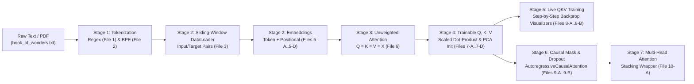

# From Tokenization to $Q, K, V$ Self-Attention (`tokenize_to_Q_K_V`)


---

## About

**`tokenize_to_Q_K_V`** is an educational, glass-box implementation of the foundational building blocks of a GPT-style Large Language Model (LLM) built from scratch in PyTorch.

Most tutorials treat layers like `nn.Embedding`, `nn.Linear`, `softmax`, and `nn.Dropout` as black boxes. This repository opens up every single matrix multiplication between raw text and a complete causal self-attention head:

- **Every intermediate tensor is printed and plotted**: See the exact shapes, values, row sums, and Shannon entropies at each step.
- **Real semantic vectors before training**: Uses pretrained 300D Google News Word2Vec vectors projected via SVD/PCA into low dimensions (3D and 6D) so you can see meaningful semantic attention patterns in 3D space and heatmaps even before training a full LLM.
- **Interactive step-by-step training visualizers**: Step through backpropagation one keypress at a time (`qkv_train_viz.py` in the terminal and `qkv_plot_viz.py` in Matplotlib) to watch $W_Q, W_K, W_V$, gradients $\frac{\partial L}{\partial W}$, and Adam updates evolve live while all other parameters are held frozen.

*Inspired by and built alongside Sebastian Raschka's **Build a Large Language Model (From Scratch)**.*

---

## End-to-End Pipeline Covered in This Repo



---

## Mathematical Progression

1. **Token & Positional Embeddings (`Files 5-A & 5-B`)**:
   $$X = E_{\text{token}}(\text{ids}) + E_{\text{pos}}(0 \dots T-1) \in \mathbb{R}^{T \times d_{\text{in}}}$$
2. **Self-Attention Without Trainable Weights (`File 6`)**:
   $$\text{Attention}(X) = \text{softmax}(X X^T) X$$
3. **Scaled Dot-Product Self-Attention With Trainable $W_Q, W_K, W_V$ (`Files 7-A – 7-D`)**:
   $$Q = X W_Q, \quad K = X W_K, \quad V = X W_V$$
   $$\text{Attention}(Q, K, V) = \text{softmax}\!\left(\frac{Q K^T}{\sqrt{d_k}}\right) V$$
4. **Causal (Masked) Self-Attention (`File 9-A`)**:
   $$S_{ij}^{\text{causal}} = \begin{cases} \dfrac{q_i \cdot k_j}{\sqrt{d_k}} & \text{if } j \le i \\ -\infty & \text{if } j > i \text{ (future token)} \end{cases}, \quad A = \text{softmax}(S^{\text{causal}})$$
5. **Causal Self-Attention With Inverted Dropout (`File 9-B`)**:
   $$\tilde{A}_{ij} = \begin{cases} 0 & \text{with probability } p \\ \dfrac{A_{ij}}{1 - p} & \text{with probability } 1 - p \end{cases}, \quad Z = \tilde{A} V$$
6. **Multi-Head Attention via Stacking (`File 10-A`)**:
   $$\text{MHA}_{\text{wrapper}}(X) = \text{Concat}\big(\text{head}_1(X),\, \text{head}_2(X),\, \dots,\, \text{head}_h(X)\big) \in \mathbb{R}^{T \times (h \cdot d_{\text{out}})}$$

---

## Setup & Installation

### 1. Create a Virtual Environment & Install Dependencies
```bash
python3 -m venv .venv
source .venv/bin/activate
pip install -r requirements.txt
```

### 2. Download the Pretrained Word2Vec Cache (One-Time Setup)
Files 5-C through 9-B use pretrained 300-dimensional Google News Word2Vec vectors (`word2vec-google-news-300`) reduced via SVD/PCA so that attention scores operate on meaningful word embeddings immediately.

Run the downloader once to cache `word2vec-google-news-300.kv` and `word2vec-google-news-300.kv.vectors.npy` locally (excluded from Git via `.gitignore`):
```bash
python word2vec_download.py
```

---

## Stage-by-Stage File Guide

### Stage 1: Tokenization (`File 1` & `File 2`)
| Step | File | Description | How to Run |
| :--- | :--- | :--- | :--- |
| **File 1** | `tokenizer.py` | Builds a regex-based word & punctuation tokenizer (`TokenizerV1`) from scratch on Project Gutenberg's *The Book of Wonders* (`book_of_wonders.txt`), including `<\|unk\|>` and `<\|endoftext\|>` special tokens. | `python tokenizer.py` |
| **File 2** | `bpe_tokenizer.py` | Introduces subword Byte-Pair Encoding (BPE) using OpenAI's `tiktoken` (`gpt2` vocabulary) to handle arbitrary out-of-vocabulary words without `<\|unk\|>`. | `python bpe_tokenizer.py` |

### Stage 2: Training Data Preparation & Embeddings (`File 3` – `File 5-D`)
| Step | File | Description | How to Run |
| :--- | :--- | :--- | :--- |
| **File 3** | `input_for_training.py` | Implements a sliding-window PyTorch `Dataset` (`GPTDatasetV1`) and `DataLoader` (`createDataLoader`) with configurable `max_length` and `stride` to produce `(input, target)` next-token prediction pairs. | `python input_for_training.py` |
| **File 5-A** | `token_embeddings.py` | Demonstrates how token IDs map to dense vectors via `nn.Embedding` (and why one-hot encoding + `nn.Linear` is identical), then adds absolute positional embeddings (`embedding_layer.png`). | `python token_embeddings.py` |
| **File 5-B** | `token_embeddings_with_pdf.py` | Extends `token_embeddings.py` to ingest custom PDF documents (via `pypdf` or `langchain`) in addition to `.txt` files, cleaning the extracted text and feeding it through the same `DataLoader` and embedding pipeline. | `python token_embeddings_with_pdf.py --pdf mybook.pdf --pages 1-10`<br>or<br>`python token_embeddings_with_pdf.py --text book_of_wonders.txt` |
| **File 5-C** | `google-news-word2vec.py` | Explores vector arithmetic (`king - man + woman`), cosine similarity, and nearest neighbors in the 300D `word2vec-google-news-300` embedding space. | `python google-news-word2vec.py` |
| **File 5-D** | `word2vec_download.py` | One-time helper script that downloads and saves `word2vec-google-news-300.kv` to disk for fast offline loading in Files 6–9. | `python word2vec_download.py` |

### Stage 3: Self-Attention Without Trainable Weights (`File 6`)
| Step | File | Description | How to Run |
| :--- | :--- | :--- | :--- |
| **File 6** | `attention_without_trainable_weights.py` | Computes raw dot-product self-attention directly on 3D Word2Vec embeddings ($Q = K = V = X$). Includes interactive 3D vector plots (toggleable input vs. context vectors), an attention weight heatmap, and per-token Shannon entropy analysis. | `python attention_without_trainable_weights.py "the dog chased the cat because it was very hungry"` |

### Stage 4: Self-Attention With Trainable $Q, K, V$ Weights (`File 7-A` – `7-D`)
| Step | File | What It Adds | How to Run |
| :--- | :--- | :--- | :--- |
| **File 7-A** | `attention_with_Q_K_V.py` | Core `SelfAttentionv1(nn.Module)` implementation with `nn.Linear` projections for $W_Q, W_K, W_V$ and $\sqrt{d_k}$ scaling on 3D Word2Vec embeddings ($d_{\text{in}}=3 \to d_{\text{out}}=2$). | `python attention_with_Q_K_V.py "the dog chased the cat because it was very hungry"` |
| **File 7-B** | `attention_with_Q_K_V_with_visuals.py` | Adds visual matrix-multiplication heatmaps ($A \times B = C$), an attention weight heatmap, per-word attention entropy, and top-$k$ attended words. | `python attention_with_Q_K_V_with_visuals.py "the dog chased the cat because it was very hungry"` |
| **File 7-C** | `attention_with_Q_K_V_withPCA.py` | Adds `--pca-init` (`init_qkv_from_pca`) on 3D embeddings ($3\text{D} \to 2\text{D}$) to compare random untrained $W_Q, W_K, W_V$ projections against variance-preserving PCA initialization. | `python attention_with_Q_K_V_withPCA.py "the dog chased the cat because it was very hungry" --pca-init` |
| **File 7-D** | `attention_with_Q_K_V_higherDimensions.py` | Expands input embeddings from 3D to 6D ($d_{\text{in}}=6 \to d_{\text{out}}=5$) so PCA initialization and $Q, K, V$ projections retain richer semantic structure, printing `WQuery.weight` before and after `--pca-init`. | `python attention_with_Q_K_V_higherDimensions.py "the dog chased the cat because it was very hungry" --pca-init` |

### Stage 5: Interactive $Q, K, V$ Training Visualizers (`File 8-A` & `8-B`)
Watch $W_Q, W_K, W_V$ learn step-by-step during backpropagation on a causal next-word prediction task while all other parameters (embeddings, positional encodings, $W_O$, unembedding) are held frozen.

| Step | File | Description | How to Run |
| :--- | :--- | :--- | :--- |
| **File 8-A** | `qkv_train_viz.py` | **Terminal UI visualizer**: Step through training (`[Enter]` for 1 step, `[N]` for $N$ steps, `[d]` to toggle $\Delta$ mode) and watch $W_Q, W_K, W_V$, $Q, K, V$, causal attention weights, and next-word probabilities update live in the terminal. | `python qkv_train_viz.py`<br>or<br>`python qkv_train_viz.py --sentence "the dog chased the ball across the quiet park"` |
| **File 8-B** | `qkv_plot_viz.py` | **Matplotlib interactive dashboard**: Choose **Single-Word** or **Full-Sentence** loss scope at startup, then step through training with `[Space]`/`[Enter]`. Displays live heatmaps of $W_Q, W_K, W_V$, a plain-English breakdown of what the last gradient step changed, and (for short sentences) the exact chain-rule gradients $\frac{\partial L}{\partial W_Q}, \frac{\partial L}{\partial W_K}, \frac{\partial L}{\partial W_V}$ and Adam update arithmetic. | `python qkv_plot_viz.py`<br>or<br>`python qkv_plot_viz.py --sentence "dogs chase cats"` |

### Stage 6: Causal (Masked) Self-Attention & Dropout (`File 9-A` & `9-B`)
| Step | File | Description | How to Run |
| :--- | :--- | :--- | :--- |
| **File 9-A** | `causal_attention.py` | Introduces `CausalSelfAttention(nn.Module)` so each token can only attend to itself and earlier tokens. Walks through both the naive `torch.tril` + row renormalization method and the standard Transformer `-inf` `masked_fill` before `softmax` (using `register_buffer`), with a 4-panel visual pipeline and side-by-side Unmasked vs. Causal heatmap comparison. | `python causal_attention.py "the dog chased the cat because it was very hungry" --pca-init` |
| **File 9-B** | `causal_attention_with_dropout.py` | Adds attention-weight dropout (`nn.Dropout(p)`) to form the complete `CausalAttention` class (supporting both 2D single sentences and 3D batches). Demonstrates PyTorch's inverted dropout $\frac{1}{1-p}$ rescaling, a 4-panel dropout decision & weight-shift visual pipeline, and `model.train()` vs. `model.eval()` comparison. | `python causal_attention_with_dropout.py "the dog chased the cat because it was very hungry" --dropout 0.5 --pca-init` |

### Stage 7: Multi-Head Attention (`File 10-A`)
| Step | File | Description | How to Run |
| :--- | :--- | :--- | :--- |
| **File 10-A** | `multi_head_attention_wrapper.py` | Introduces `MultiHeadAttentionWrapper(nn.Module)` by stacking `num_heads` independent `CausalAttention` modules in an `nn.ModuleList` and concatenating their outputs along `dim=-1`. Supports `--pca-init` with orthogonal PCA subspaces per head, side-by-side per-head attention heatmaps + divergence panel, a concatenation matrix diagram, and 3D batched inputs. | `python multi_head_attention_wrapper.py "the dog chased the cat because it was very hungry" --num-heads 2 --head-dim 2 --pca-init` |
